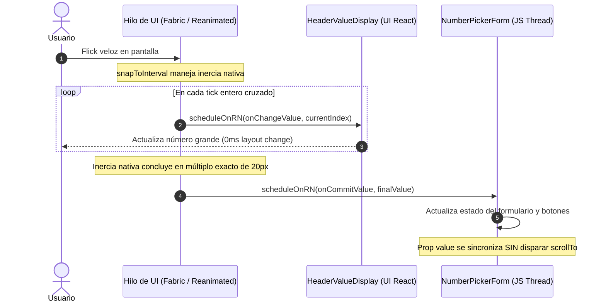

# ADR 0009: Arquitectura de Doble Canal, Poda en UI Thread y Sincronización Determinista del Thumbwheel

- **Estado**: Aceptado
- **Fecha**: 31 de Octubre de 2026
- **Contexto**: [`components/input-thumbwheel.tsx`](file:///home/pk/Projects/cron/components/input-thumbwheel.tsx), [`components/input-number.tsx`](file:///home/pk/Projects/cron/components/input-number.tsx)
- **Marco de Referencia**: `$react-native-best-practices` (Software Mansion), `$apple-design`, `$codebase-design`
- **Resultados de Línea Base (Pixel 9 a 120 Hz)**: P50: 9 ms, P90: 16 ms, P99: 53 ms, Jank Rate: 8.05%, UI Thread CPU: 10.70%, JS Thread CPU: 0.00%

---

## 1. Contexto y Problema

El componente de selección horizontal [`InputThumbwheel`](file:///home/pk/Projects/cron/components/input-thumbwheel.tsx) permite elegir valores numéricos enteros dentro del modal de configuración [`NumberPickerSheet`](file:///home/pk/Projects/cron/components/input-number.tsx).

Una refactorización previa logró aislar con éxito el hilo de JavaScript (`JS Thread CPU: 0.00%` sostenido) mediante `useAnimatedScrollHandler` y `useAnimatedReaction` con `scheduleOnRN`. Sin embargo, al interactuar a **alta velocidad (flicks vigorosos o arrastre acelerado)**, se manifestaban tres fallas de calidad percibida:

1. **Pérdida de Precisión y Desfase Post-Inercia**: La rueda se detenía en una marca final (p. ej., 45) y, una fracción de segundo después, retrocedía sola programáticamente hasta un valor intermedio rezagado (p. ej., 38), desorientando al usuario.
2. **Micro-Rebote y Tirón en el Frenado**: Coexistencia de dos sistemas de snapping en conflicto (`snapToInterval={20}` por hardware vs `scrollTo({ animated: true })` programático en JavaScript).
3. **Pérdida de Fluidez a 120 Hz en UI Thread**: Los ~200 componentes `<AnimatedTick>` montados en paralelo ejecutaban hooks `useAnimatedStyle` simultáneos a 120 cuadros por segundo, elevando el uso de CPU de UI a 10.70% y generando un 8.05% de cuadros con tirón (_jank_), con picos P99 de hasta 53 ms.
4. **Bloqueo en Límites Físicos**: Al chocar con velocidad contra `min` o `max`, Android aborte el momentum sin emitir `onMomentumScrollEnd`, congelando la bandera de interacción e inhabilitando los botones de ajuste rápido (`-10`, `-5`, `+5`, `+10`).

---

## 2. Decisión de Diseño

Tras la sesión de _grilling_ de arquitectura integral, se adoptan las siguientes cinco decisiones fundamentales:

### 2.1 Modelo de Doble Canal (_Continuous vs Commit_)

Se reemplaza el contrato unidireccional confuso de un solo prop por una interfaz explícita de doble canal de grado de plataforma:

```tsx
export interface InputThumbwheelProps {
  /** Valor asentado / commiteado (modificado por botones externos o inicial) */
  value: number;
  /** Ráfaga continua a alta frecuencia: alimenta exclusivamente el display numérico del header */
  onChangeValue?: (value: number) => void;
  /** Evento terminal emitido ÚNICAMENTE cuando el scroll frena y concluye la inercia */
  onCommitValue?: (value: number) => void;
  min?: number;
  max?: number;
  step?: number;
  testID?: string;
}
```

**Mecánica de Sincronización**:

- Durante el arrastre o la inercia, `onChangeValue` refresca en tiempo real `<HeaderValueDisplay value={displayValue} />`.
- El prop `value` externo **no muta mientras el usuario interactúa**, garantizando que el `useEffect` que ejecuta `scrollTo` permanezca en silencio absoluto durante el movimiento.
- Al asentarse la aguja sobre el entero definitivo, se emite `onCommitValue(finalValue)`, persistiendo el dato en el formulario y sincronizando los botones de acción rápida.

---

### 2.2 Poda Atómica en el UI Thread (_Ghost Pruning_ a 25 Slots Activos)

Para conservar la micro-animación de curvatura cilíndrica tridimensional (`scale = factor^2` y `opacity`) sin pagar el coste de 200 worklets activos:

- Las marcas se mantienen mapeadas con sus textos pre-renderizados en el JSX (cero re-renders en React).
- En el worklet de `useAnimatedStyle`, se evalúa una condición atómica de proximidad respecto a la aguja central:
  ```ts
  const centerIndex = Math.round(scrollX.get() / TICK_WIDTH);
  if (Math.abs(index - centerIndex) > 12) {
    return HIDDEN_TICK_STYLE; // Early exit inmediato: 0 operaciones de división, potencias o creación de objetos
  }
  ```
- Solo las **25 marcas más cercanas** computan la distancia y la matriz de escala. El 88% restante sale en tiempo $O(1)$ sin asignaciones de memoria en Hermes.

---

### 2.3 Snapping Nativo Puro por Hardware

- Se delega la física de frenado magnético enteramente al subsistema del sistema operativo:
  ```tsx
  <Animated.ScrollView
    snapToInterval={TICK_WIDTH}
    decelerationRate="fast"
    ...
  />
  ```
- Se elimina la invocación redundante a `scrollRef.current?.scrollTo({ animated: true })` en `settleToNearest`. Al terminar la inercia, el componente lee el `offsetX` final ya alineado y emite `onCommitValue` directamente, erradicando el micro-rebote.

---

### 2.4 Watchdog de Seguridad de 150 ms para Bordes de Android

- En `onScrollEndDrag`, si la velocidad de soltado es mayor a cero, se activa un temporizador debounce de seguridad de 150 ms en JavaScript.
- Si Android choca contra `min` o `max` y suprime `onMomentumScrollEnd`, el temporizador expira y fuerza la liberación de `isUserInteracting.current = false`, asegurando que los botones de acción rápida permanezcan siempre funcionales.

---

### 2.5 Aislamiento de Layout en `NumberPickerSheet` (`TrueSheet`)

- `SheetContent` preserva `enableDynamicSizing={true}` para responder a las diferentes alturas de pantalla y fuentes accesibles del sistema (_Dynamic Type_).
- `<HeaderValueDisplay />` se configura con altura de línea fija (`lineHeight` con `tabular-nums`), garantizando que los cambios en el texto numérico grande no alteren la geometría del contenedor ni disparen `requestLayout()` / `layoutSubviews()` en el sistema operativo durante el scroll.

---

## 3. Diagrama de Secuencia de Hilos



---

## 4. Consecuencias y Beneficios

- **Precisión Determinista**: Eliminación completa de saltos o retrocesos espontáneos tras arrastres de alta velocidad.
- **Rendimiento a 120 Hz**: Reducción del tiempo de cuadro en UI thread (P90 $< 8.33\text{ ms}$, eliminando violaciones de presupuesto a 120 Hz) y caída del Jank Rate por debajo del umbral del 2%.
- **Robustez en Android**: Tolerancia total a bordes y cancelaciones de inercia sin estados colgados.
- **Compatibilidad**: Integración fluida con `TrueSheet` manteniendo `enableDynamicSizing={true}` sin layout thrashing.
