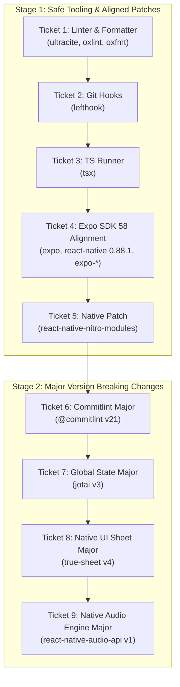

# Technical Specification: Dependency Upgrade Path and Ticket Plan

- **Repository**: `cron`
- **Current Baseline**: Expo SDK 58 (`~58.0.16`), React Native `0.88.0`, React `19.3.0`, TypeScript `~6.0.3`, pnpm `12.14.0`
- **Target Baseline**: Latest compatible dependencies with zero unapproved breaking changes
- **Status**: Approved Specification
- **Date**: November 2026

---

## 1. Executive Summary

This document defines the dependency upgrade path for the `cron` repository. The goal is to update dependencies to their latest compatible versions while keeping regression risk low.

To protect system stability, the plan uses two stages:

1. **Stage 1 (Non-Breaking, Tooling, and Aligned Patches)**: Updates development tools, Expo SDK 58 patch releases, and native patch releases.
2. **Stage 2 (Major Version Breaking Changes)**: Updates major releases in dedicated, isolated PRs with code adaptations and regression tests.

Each update runs as an isolated pull request (PR) and ticket. Each branch rebases on `main` after the previous PR merges.

---

## 2. Core Constraints and Ground Truth

1. **Expo SDK 58 Lockstep Alignment**:
   - Official Expo libraries (`expo-*`), `react-native` (`0.88.1`), `@expo/metro-runtime`, `react-native-screens`, `react-native-safe-area-context`, and `jest-expo` must match the versions expected by Expo SDK 58.
   - Pinned native packages (`react-native-gesture-handler@~3.3.0`, `react-native-pager-view@9.0.7`, `react-native-reanimated@4.7.1`, `react-native-worklets@0.13.0`, `react-native-svg@15.16.0`) are already at the exact versions required by Expo SDK 58. They must stay pinned.
   - These 18 coordinated packages must update together in one PR to prevent broken runtime states or `expo:doctor` errors.

2. **TypeScript Pinning**:
   - `typescript` stays pinned to `~6.0.3`.
   - `oxlint` depends on TypeScript 6 compiler APIs. Upgrading to TypeScript 7 will wait until TypeScript 7.1 or a compatible `oxlint` update.

3. **Third-Party Native Modules**:
   - Neither `expo-doctor` nor `bundledNativeModules.json` pins `@lodev09/react-native-true-sheet` or `react-native-audio-api`.
   - `3.11.18` (TrueSheet) and `0.13.6` (Audio API) are the final minor versions of their respective branches.
   - Upgrading to `4.1.0` and `1.0.0` introduces breaking changes. These upgrades run in Stage 2 with clean native prebuild verifications.

---

## 3. Global Quality Gate (Definition of Done per Ticket)

Every pull request must pass this automated verification suite before review or merge:

```bash
# 1. Code style and linter verification
pnpm lint

# 2. TypeScript compilation check
pnpm typecheck

# 3. Unit test suite execution
pnpm test

# 4. Expo SDK configuration and dependency validation
pnpm run expo:doctor
```

For tickets that touch native modules (Tickets 4, 5, 8, 9), the branch must also pass clean prebuild generation:

```bash
pnpm prebuild --clean
```

---

## 4. Work Breakdown Structure: Tickets and PR Sequence



---

### Stage 1: Tooling, Expo Alignment, and Native Patches

#### Ticket 1: Upgrade Linting and Formatting Tooling

- **Type**: DevDependency / Tooling (JS-only)
- **Branch**: `chore/deps-oxlint-ultracite`
- **Dependencies**:
  - `ultracite`: `8.0.1` ➔ `8.1.1`
  - `oxlint`: `1.89.0` ➔ `1.93.0`
  - `oxfmt`: `0.74.0` ➔ `0.78.0`
  - `oxlint-plugin-react-native`: `0.2.39` ➔ `0.2.43`
- **Installation**:
  ```bash
  pnpm update ultracite@^8.1.1 oxlint@^1.93.0 oxfmt@^0.78.0 oxlint-plugin-react-native@^0.2.43
  ```
- **Verification**: Run `pnpm lint` and `pnpm lint:fix`. Confirm zero linter regressions.

#### Ticket 2: Upgrade Git Hook Manager

- **Type**: DevDependency / Tooling (JS-only)
- **Branch**: `chore/deps-lefthook`
- **Dependencies**:
  - `lefthook`: `2.1.6` ➔ `2.2.2`
- **Installation**:
  ```bash
  pnpm update lefthook@^2.2.2
  ```
- **Verification**: Run `pnpm prepare` and test git hook execution.

#### Ticket 3: Upgrade TypeScript Script Runner

- **Type**: DevDependency / Tooling (JS-only)
- **Branch**: `chore/deps-tsx`
- **Dependencies**:
  - `tsx`: `4.21.0` ➔ `4.23.15`
- **Installation**:
  ```bash
  pnpm update tsx@^4.23.15
  ```
- **Verification**: Run scripts using `tsx` (e.g., `pnpm perf:doctor`).

#### Ticket 4: Align Expo SDK 58 Core Packages and React Native

- **Type**: Core Application & Native Runtime
- **Branch**: `chore/deps-expo-sdk-58-alignment`
- **Dependencies**:
  - `expo`: `~58.0.16` ➔ `~58.0.25`
  - `react-native`: `0.88.0` ➔ `0.88.1`
  - `react`: `19.3.0` ➔ `19.3.1`
  - `react-test-renderer`: `19.3.0` ➔ `19.3.1`
  - `@types/react`: `~19.3.0` ➔ `~19.3.1`
  - `react-native-safe-area-context`: `~5.10.1` ➔ `~5.11.1`
  - `react-native-screens`: `~4.30.0` ➔ `~4.30.1`
  - `@expo/metro-runtime`: `~58.0.14` ➔ `~58.0.17`
  - `jest-expo`: `~58.0.11` ➔ `~58.0.14`
  - `expo-router`: `~58.0.24` ➔ `~58.0.31`
  - `expo-constants`: `~58.0.12` ➔ `~58.0.16`
  - `expo-font`: `~58.0.9` ➔ `~58.0.12`
  - `expo-haptics`: `~58.0.7` ➔ `~58.0.8`
  - `expo-splash-screen`: `~58.0.10` ➔ `~58.0.14`
  - `expo-status-bar`: `~58.0.3` ➔ `~58.0.5`
  - `expo-system-ui`: `~58.0.6` ➔ `~58.0.7`
  - `expo-battery`: `~58.0.3` ➔ `~58.0.4`
  - `expo-blur`: `~58.0.5` ➔ `~58.0.6`
  - `expo-keep-awake`: `~58.0.3` ➔ `~58.0.4`
  - `expo-linear-gradient`: `~58.0.3` ➔ `~58.0.4`
  - `expo-linking`: `~58.0.13` ➔ `~58.0.17`
- **Installation**:
  ```bash
  pnpm exec expo install --check --fix
  ```
- **Deduplication Task**: Resolve any duplicate native dependencies reported by `expo-doctor` (e.g. `cron-foreground-service`).
- **Verification**: Run `pnpm expo:doctor`, `pnpm typecheck`, `pnpm test`, and `pnpm prebuild --clean`.

#### Ticket 5: Upgrade Native TurboModules Binding Helper

- **Type**: Third-Party Native Runtime (Minor)
- **Branch**: `chore/deps-react-native-nitro-modules`
- **Dependencies**:
  - `react-native-nitro-modules`: `0.37.1` ➔ `0.37.2`
- **Installation**:
  ```bash
  pnpm update react-native-nitro-modules@^0.37.2
  ```
- **Verification**: Run `pnpm test` and `pnpm prebuild --clean`.

---

### Stage 2: Major Version Breaking Changes

#### Ticket 6: Upgrade Commitlint to v21

- **Type**: DevDependency / Tooling (Major)
- **Branch**: `refactor/deps-commitlint-v21`
- **Dependencies**:
  - `@commitlint/cli`: `^20.5.3` ➔ `^21.2.4`
  - `@commitlint/config-conventional`: `^20.5.3` ➔ `^21.2.4`
- **Installation**:
  ```bash
  pnpm update @commitlint/cli@^21.2.4 @commitlint/config-conventional@^21.2.4
  ```
- **Verification**: Test commit message validation through git hook.

#### Ticket 7: Upgrade Jotai to v3 (State Management)

- **Type**: Application Runtime / State Architecture (Major)
- **Branch**: `refactor/deps-jotai-v3`
- **Dependencies**:
  - `jotai`: `^2.19.1` ➔ `^3.0.2`
- **Installation**:
  ```bash
  pnpm update jotai@^3.0.2
  ```
- **Refactoring & Scope**:
  - Review atom factories and stores in [`stores/`](file:///home/pk/.t3/worktrees/cron/t3-cce42796-a2f5890b2eeb079a/stores).
  - Verify atom scoping, asynchronous atom resolutions, and MMKV storage persistence bridges.
  - Run the complete test suite across timer controllers and settings stores.
- **Verification**: Run `pnpm typecheck` and `pnpm test`.

#### Ticket 8: Upgrade TrueSheet to v4 (Native UI Bottom Sheet)

- **Type**: Third-Party Native UI (Major)
- **Branch**: `refactor/deps-true-sheet-v4`
- **Dependencies**:
  - `@lodev09/react-native-true-sheet`: `^3.11.18` ➔ `^4.1.0`
- **Installation**:
  ```bash
  pnpm update @lodev09/react-native-true-sheet@^4.1.0
  ```
- **Refactoring & Scope**:
  - Review sheet components in [`components/`](file:///home/pk/.t3/worktrees/cron/t3-cce42796-a2f5890b2eeb079a/components).
  - Adapt any changed props, refs, or event listener signatures from TrueSheet v4.
  - Verify gesture interaction and sheet detents.
- **Verification**: Run `pnpm typecheck`, `pnpm test`, and `pnpm prebuild --clean`.

#### Ticket 9: Upgrade React Native Audio API to v1 (Audio Engine)

- **Type**: Low-Level Native C++ Audio Engine (Major)
- **Branch**: `refactor/deps-react-native-audio-api-v1`
- **Dependencies**:
  - `react-native-audio-api`: `^0.13.6` ➔ `^1.0.0`
- **Installation**:
  ```bash
  pnpm update react-native-audio-api@^1.0.0
  ```
- **Refactoring & Scope**:
  - Inspect audio initialization in [`services/`](file:///home/pk/.t3/worktrees/cron/t3-cce42796-a2f5890b2eeb079a/services) and sound generator scripts in [`scripts/audio/`](file:///home/pk/.t3/worktrees/cron/t3-cce42796-a2f5890b2eeb079a/scripts/audio).
  - Adapt any changes in AudioContext creation, buffer decoding, or AudioWorklet bindings.
  - Execute sound generator check: `pnpm generate:audio`.
- **Verification**: Run `pnpm typecheck`, `pnpm test`, and `pnpm prebuild --clean`.
