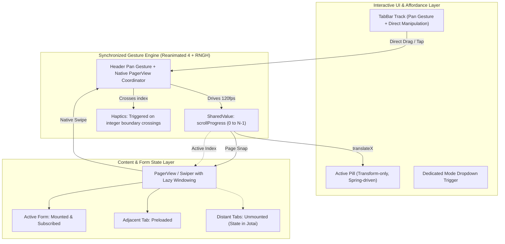

# Menu Navigation: Performance, UX Affordances, and Architecture Research

> **Status:** Completed  
> **Target:** `screens/menu` (`FormPager`, `useTimerForms`, `useFormPager`)  
> **References:** React Native 0.88 (React 19), Reanimated 4.7.1, RNGH 3.3.0, PagerView 9.0.7  
> **Relevant Skills Applied:** `$react-native-best-practices`, `$vercel-react-native-skills`, `$apple-design`, `$emil-design-eng`, `$animate-expo`, `$find-animation-opportunities`, `$vercel-composition-patterns`

---

## 1. Executive Summary

The custom tab navigation component in [`screens/menu`](file:///home/pk/Projects/cron/screens/menu) was developed to provide a signature, branded experience: a horizontally sliding segmented header with an expanding white active pill, a dropdown mode menu, and a paging container for workout configuration forms ([`ForTimeForm`](file:///home/pk/Projects/cron/screens/menu/components/forms/for-time-form.tsx), [`AmrapForm`](file:///home/pk/Projects/cron/screens/menu/components/forms/amrap-form.tsx), [`IntervalForm`](file:///home/pk/Projects/cron/screens/menu/components/forms/interval-form.tsx), [`EmomForm`](file:///home/pk/Projects/cron/screens/menu/components/forms/emom-form.tsx), and [`StopWatchForm`](file:///home/pk/Projects/cron/screens/menu/components/forms/stopwatch-form.tsx)).

Following the migration to **React Native 0.88 (React 19)**, **Reanimated 4.7.1**, and **React Native Gesture Handler 3.3.0** on the New Architecture (Fabric), three distinct problems surfaced:

1. **The Tab-Switching Infinite Loop Bug:**
   - Caused by a double `currentIndexRef` desynchronization between [`use-form-pager.tsx`](file:///home/pk/Projects/cron/screens/menu/components/form-pager/use-form-pager.tsx) and [`form-pager/index.tsx`](file:///home/pk/Projects/cron/screens/menu/components/form-pager/index.tsx), combined with Fabric ref-forwarding errors in `createAnimatedComponent(PagerView)`. Programmatic `setPage` calls and native `onPageSelected` events trigger a cyclical update ping-pong.
2. **Performance Degradation (Sluggish Frame Rates):**
   - **Continuous Layout Passes (Yoga):** Animating `width` on flex items (`AnimatedTabWrapper` and `activeZone`) on every frame forces Yoga layout recalculations on the UI thread for all sibling elements.
   - **Mount Render Storm:** Measuring 5 tab widths individually via React state updates (`setTabWidths` and `setTabHeight`) causes up to 10 cascading re-renders on mount, while hiding the tab bar behind `opacity: 0`.
   - **Eager Rendering of All Form Trees:** All 5 workout forms—including TanStack Form instances, Jotai atom subscriptions, and ScrollViews—are kept mounted and active simultaneously. Inline render callbacks re-render every form whenever the footer height changes.
3. **UX & Affordance Breakdown:**
   - **Direct Manipulation Violation:** The top tab bar visually resembles a draggable carousel or slider, but its track does not handle pan gestures. When new users attempt to swipe the header titles, their touch is swallowed or ignored.
   - **Mental Model Mismatch:** Workout forms are vertical pages. Users do not intuitively suspect that a vertical form area scrolls horizontally unless presented with visual signifiers (such as edge peeking, page indicators, or a responsive, touch-draggable header bar).

---

## 2. Forensic Diagnosis: The Tab-Switching Loop Bug

### 2.1 The Double-Ref Desynchronization Loop

In the existing codebase, page state synchronization is split between [`use-form-pager.tsx`](file:///home/pk/Projects/cron/screens/menu/components/form-pager/use-form-pager.tsx) and [`form-pager/index.tsx`](file:///home/pk/Projects/cron/screens/menu/components/form-pager/index.tsx). Both files independently instantiate a `currentIndexRef`:

```tsx
// screens/menu/components/form-pager/use-form-pager.tsx (Lines 32, 148-154)
const safeActiveIndex = propIndex >= 0 ? propIndex : internalIndex;
const currentIndexRef = useRef(safeActiveIndex);

useEffect(() => {
  if (propIndex >= 0 && propIndex !== currentIndexRef.current) {
    pagerRef.current?.setPage(propIndex);
    currentIndexRef.current = propIndex;
  }
}, [propIndex, currentIndexRef, pagerRef]);
```

```tsx
// screens/menu/components/form-pager/index.tsx (Lines 95-104)
const currentIndexRef = useRef(Math.max(propIndex, 0));

useEffect(() => {
  if (propIndex >= 0 && propIndex !== currentIndexRef.current) {
    pagerRef.current?.setPage(propIndex);
    currentIndexRef.current = propIndex;
  }
}, [propIndex, pagerRef, currentIndexRef]);
```

#### The Execution Cycle:

1. When the user swipes or selects a page, `PagerView` fires `onPageSelected`.
2. [`use-form-pager.tsx`](file:///home/pk/Projects/cron/screens/menu/components/form-pager/use-form-pager.tsx#L163) handles this in `handlePageSelected`:
   ```tsx
   if (newIndex !== currentIndexRef.current) {
     currentIndexRef.current = newIndex;
     setInternalIndex(newIndex);
     onValueChange?.(options[newIndex].value);
   }
   ```
3. This updates `currentIndexRef` **only inside `use-form-pager.tsx`**.
4. `onValueChange` invokes `setCurrentMode` in [`screens/menu/index.tsx`](file:///home/pk/Projects/cron/screens/menu/index.tsx#L17).
5. [`screens/menu/index.tsx`](file:///home/pk/Projects/cron/screens/menu/index.tsx) re-renders, passing `value={currentMode}` back down to `FormPager`.
6. Inside [`form-pager/index.tsx`](file:///home/pk/Projects/cron/screens/menu/components/form-pager/index.tsx#L96), its **local `currentIndexRef` was never updated** by `handlePageSelected`. Its value is still the initial index (e.g., `0`).
7. As a result, `propIndex !== currentIndexRef.current` evaluates to `true` (e.g., `1 !== 0`).
8. The `useEffect` inside `index.tsx` immediately executes `pagerRef.current?.setPage(propIndex)`.
9. In `react-native-pager-view` 9.x under Fabric, calling `setPage()` while the native view is settling or has just emitted its selected event dispatches another transition, triggering `onPageScroll` and `onPageSelected` again, generating an oscillating render and event loop.

### 2.2 Fabric Ref Forwarding Error in `createAnimatedComponent`

The integration with Reanimated 4 and React 19 surfaces another critical issue in the test logs:

```
console.error: dispatchCommand was called with a ref that isn't a native component.
Use React.forwardRef to get access to the underlying native component
at PagerView.setPage (node_modules/react-native-pager-view/src/PagerView.tsx:116:31)
at setPage (screens/menu/components/form-pager/index.tsx:101:25)
```

In [`screens/menu/components/form-pager/index.tsx`](file:///home/pk/Projects/cron/screens/menu/components/form-pager/index.tsx#L45):

```tsx
const AnimatedPagerView = createAnimatedComponent(PagerView);
```

In Reanimated 4, `createAnimatedComponent` wraps the component class. When passing `ref={pagerRef}`:

- `pagerRef.current` references the Reanimated wrapper instance rather than the native component handle.
- React 19 removed the legacy ref pattern and altered ref attachment semantics.
- When `PagerView.setPage` invokes `PagerViewNativeCommands.setPage(this.pagerView, selectedPage)`, the Fabric command dispatcher fails because `this.pagerView` does not match the expected native shadow node.
- Furthermore, `AnimatedPagerView` does **not** consume any animated styles or props—it is styled with static `{ flex: 1 }`. Wrapping it in `createAnimatedComponent` introduces overhead and ref incompatibilities without any benefit.

### 2.3 Absence of Gesture/Scroll State Guards

Neither `useFormPager` nor `FormPager` tracks `onPageScrollStateChanged` (`idle`, `dragging`, `settling`). If a state update or external prop change occurs while the user is actively dragging the pager, `pagerRef.current?.setPage()` interrupts the gesture, causing native touch cancellation and violent snapping.

---

## 3. Performance Bottlenecks & Architectural Flaws

### 3.1 Animating Layout Properties (`width`) on Flex Items

In [`screens/menu/components/form-pager/components/animated-tab.tsx`](file:///home/pk/Projects/cron/screens/menu/components/form-pager/components/animated-tab.tsx#L21-L32):

```tsx
const animatedWidthStyle = useAnimatedStyle(() => {
  if (!baseWidth) {
    return { width: 0 };
  }
  const extraWidth = interpolate(
    scrollPosition.value,
    [index - 1, index, index + 1],
    [0, ICON_SPACE, 0],
    Extrapolation.CLAMP
  );
  return { width: baseWidth + extraWidth };
}, [baseWidth, index]);
```

And in [`screens/menu/components/form-pager/index.tsx`](file:///home/pk/Projects/cron/screens/menu/components/form-pager/index.tsx#L118-L130):

```tsx
const activeZoneAnimatedStyle = useAnimatedStyle(() => {
  const width = interpolate(
    scrollPosition.value,
    safeInputRange,
    safePillWidths,
    Extrapolation.CLAMP
  );
  return { width: width + ICON_SPACE };
}, [allWidthsMeasured, safeInputRange, safePillWidths]);
```

#### Why this hurts performance:

As documented in the `$react-native-best-practices` and `$animate-expo` guidelines:

- **`transform` and `opacity` are GPU-composited and cost 0 layout passes.**
- Animating `width`, `height`, `left`, `right`, or `margin` on items in a flex container (`movingTrack` with `flexDirection: "row"`) forces Yoga to run a full layout pass on every frame for that node **and all of its sibling nodes**.
- With 5 tabs, there are 5 active instances of `AnimatedTabWrapper` interpolating `width`, plus `activeZone` interpolating `width`, generating 6 continuous Yoga layout passes per frame at 60/120 Hz during any swipe.

### 3.2 Mount-Time Render Cascades (`useTabMeasurements`)

In [`screens/menu/components/form-pager/use-form-pager.tsx`](file:///home/pk/Projects/cron/screens/menu/components/form-pager/use-form-pager.tsx#L53-L64):

```tsx
const handleMeasureOnLayout = useCallback(
  ({ event, index }: ViewWithIndexOnLayoutType) => {
    const { width, height } = event.nativeEvent.layout;
    setTabWidths((prev) => {
      const next = [...prev];
      next[index] = width;
      return next;
    });
    setTabHeight((prev) => Math.max(prev, height));
  },
  []
);
```

- Each measured tab dispatches two independent React state setters: `setTabWidths` and `setTabHeight`.
- For 5 tabs, this produces between 5 and 10 state update cascades on the JS thread during the initial screen render.
- While measuring, `allWidthsMeasured` is false, forcing `opacity: 0` on the container:
  ```tsx
  tabBarContainerOpacityStyles = { opacity: allWidthsMeasured ? 1 : 0 };
  ```
- This results in a noticeable layout pop-in / flash when entering the screen.

### 3.3 Heavy Off-Screen View Trees & Eager Mounting

All 5 modes (`FOR_TIME`, `AMRAP`, `INTERVAL`, `EMOM`, `STOP_WATCH`) are mounted concurrently inside `PagerView`:

- Each tab mounts a full form hierarchy with TanStack Form stores, Jotai atom subscriptions (`amrapWorkoutAtom`, `emomWorkoutAtom`, `intervalWorkoutAtom`, etc.), validator functions, and nested ScrollViews.
- In [`screens/menu/components/form-pager/index.tsx`](file:///home/pk/Projects/cron/screens/menu/components/form-pager/index.tsx#L248-L256):
  ```tsx
  {
    options.map((option) => (
      <View key={`page-${option.value || "undef"}`} style={styles.page}>
        {typeof option.content === "function"
          ? option.content({ bottom: footerHeight + 12 })
          : option.content}
      </View>
    ));
  }
  ```
- Every time `footerHeight` updates (on layout or orientation change), `option.content(...)` is re-invoked inline for every single tab, re-evaluating the JSX elements for all 5 screens simultaneously.

### 3.4 Triple-Layer Visual Rendering

To achieve the white pill overlay with dark text over the dark track with light text, the UI renders three complete copies of the tabs:

1. **Hidden measurement layer:** 5 `ViewWithIndexOnLayout` instances.
2. **Inactive track layer:** 5 `PressableWithIndex` + `AnimatedTabWrapper` instances.
3. **Active clipped layer:** 5 `AnimatedTabWrapper` instances inside the overflow-hidden `activeZone`, plus the `DropdownMenu` trigger and caret.

That represents 15+ text elements and multiple animated styles running in parallel for a simple tab bar.

---

## 4. UX & Affordance Breakdown: Why Users Fail to Discover Swipe

### 4.1 The Direct Manipulation Gap (Apple Design Principles)

Apple's WWDC _Designing Fluid Interfaces_ defines direct manipulation:

> _"Touch and content should move together. When a control represents horizontal position, touching it and moving horizontally must directly manipulate that position."_

- The header presents a visible horizontal track with titles (`FOR TIME`, `AMRAP`, `INTERVAL`, `EMOM`, `STOPWATCH`) and an indicator pill that translates horizontally as pages change.
- When a user sees an interactive horizontal track, their primary physical intuition is to **place their thumb on the track and drag it left or right**.
- However, [`movingTrack`](file:///home/pk/Projects/cron/screens/menu/components/form-pager/index.tsx#L168) only contains individual `Pressable`s, and `activeZone` is wrapped in a `<DropdownMenuTrigger>`.
- If the user swipes horizontally on the header titles:
  - Swiping on the active pill triggers the dropdown menu trigger or swallows the touch.
  - Swiping on inactive tabs is absorbed by `Pressable` without initiating any scroll or pan gesture.
  - The header feels completely frozen to horizontal dragging.

### 4.2 The Mental Model Mismatch of Form Pages

- The area below the header consists of form fields: "Time Cap" input, preset buttons, number pickers.
- In mobile design language (iOS and Android), forms are **vertical scrolling environments**. Users swipe _up and down_ to view more fields or scroll.
- Nothing in the viewport body suggests horizontal paging:
  - The pages have 100% width and horizontal padding, completely occluding adjacent tab content.
  - There are no page dots, horizontal peek margins, or directional hints.
  - The _only_ element displaying horizontal pagination cues is the top tab bar.
- Because the top tab bar is the only horizontal cue on screen, users instinctively try to drag the tab bar. When that fails, they assume the screen is locked to the current mode until they stumble upon swiping the blank body space.

---

## 5. Design Engineering Review (Emil Kowalski Framework)

In accordance with Emil Kowalski's design engineering standards, the following table details the required before-and-after improvements:

| Before | After | Why |
| --- | --- | --- |
| Duplicate `currentIndexRef` in both `use-form-pager.tsx` and `index.tsx` causing desync loops | Single state authority with bidirectional sync guard and `onPageScrollStateChanged` checking | Prevents the infinite `setPage` ping-pong loop when switching tabs |
| `createAnimatedComponent(PagerView)` wrapping a non-animated view and breaking native command refs | Standard `PagerView` with native ref forwarding or `useAnimatedPagerHandler` | Eliminates Fabric `dispatchCommand` runtime errors and restores clean native command dispatching |
| Animating `width: baseWidth + extraWidth` on tabs and active pill on every frame | Position the active pill with `transform: [{ translateX }]` and pre-calculated width interpolation or scaleX | `width` forces Yoga to re-calculate layouts for all flex siblings on every frame; `transform` runs at 120fps with 0 layout passes |
| Tab bar track ignores horizontal dragging; touches swallowed by Pressable / DropdownTrigger | Top tab bar wrapped in a pan gesture / horizontal scroll coordinator that drives page changes | Restores Direct Manipulation: users who swipe the top titles immediately scroll through tabs |
| 10 cascading state updates on mount via `handleMeasureOnLayout` hiding the bar with `opacity: 0` | Single-pass layout measurement or fixed semantic tab pill tokens with immediate initial render | Eliminates mount-time render thrashing and removes the blank flash / layout pop-in |
| All 5 workout forms eagerly mounted with active Jotai subscriptions and TanStack form stores | Lazy-mount off-screen tabs (mount active ± 1 adjacent tab) or preserve state in atoms while unmounting DOM trees | Drastically reduces memory consumption, idle subscription overhead, and frame drops |
| Inline `option.content({ bottom: footerHeight + 12 })` creating new JSX instances on every render | Stable memoized tab panels with CSS safe-area insets or context-provided footer padding | Prevents re-creating all 5 form component instances whenever footer layout changes |
| Caret rotation uses `withTiming(..., { duration: 150 })` | Caret rotation uses Apple-calibrated spring (`damping: 1.0`, `stiffness: 300`) | Springs are physical and interruptible; linear/timing curves feel robotic and disconnected from touch |
| Dropdown trigger covers entire active pill, blocking horizontal drag gestures | Dedicated chevron button for dropdown or tap-to-expand mode switcher that yields to pan gestures | Separates tap-to-select/open from horizontal drag gestures |
| No horizontal affordance in the body of the screen | Subtle adjacent page peek (2–4% overshoot) or active indicator pill affordance | Gives immediate visual feedback that the content scrolls horizontally |

---

## 6. Proposed Architecture & Modernization Strategy



### 6.1 Making the Tab Bar Draggable (Direct Manipulation)

To resolve the core UX complaint where users try to swipe the header titles, we introduce a synchronized gesture coordinator:

- Attach a horizontal `Gesture.Pan()` to the tab bar using `react-native-gesture-handler`.
- When the user drags across the tab bar:
  - Update `scrollPosition` directly on the UI thread via Reanimated worklets.
  - On gesture release, compute projection with velocity (using `withDecay` or `withSpring`) and command the pager to snap to the closest tab index (`Math.round(target)`).
  - Tapping any tab executes an instant, critically-damped spring transition to that index.

### 6.2 Eliminating Yoga Layout Passes (Transform-Only Pill)

Instead of animating `width` on in-flow elements:

1. Render the inactive tabs in a static row. Their positions and widths are fixed once measured.
2. The active highlight pill is positioned **absolutely** behind or over the text.
3. As `scrollPosition` varies from `0` to `N-1`, interpolate:
   - `translateX`: derived from tab center positions.
   - `width`: interpolated between `tabWidths[i]` and `tabWidths[i+1]` (applied only to the absolute, child-free pill).
4. The text elements remain completely static in layout and only transition their color or opacity via Reanimated styles or CSS transitions.

### 6.3 Lazy Tab Windowing

To keep memory and CPU low on mobile devices:

- Wrap each page in a lightweight windowing container.
- Only render the `FormComponent` if `Math.abs(activeIndex - index) <= 1`.
- Since each form's persistent state already lives in Jotai atoms ([`forTimeWorkoutAtom`](file:///home/pk/Projects/cron/stores/workout.ts), [`amrapWorkoutAtom`](file:///home/pk/Projects/cron/stores/workout.ts), etc.), unmounting off-screen forms causes **zero data loss**, instantly frees React component tree memory, and eliminates background re-renders.

### 6.4 Clean Synchronization & Single Ref Source

Refactor `useFormPager` so that:

- It owns the single authoritative `pageIndex` and `targetIndex`.
- `onPageScrollStateChanged` tracks whether the pager is `dragging`, `settling`, or `idle`.
- Programmatic `setPage` calls are only dispatched when the pager is in the `idle` state and the controlled `value` changes externally.
- Standard `PagerView` ref is used without `createAnimatedComponent(PagerView)`, eliminating Fabric dispatch command errors.

---

## 7. Concrete Next Steps & Action Plan

1. **Bugfix (Immediate):**
   - Consolidate the dual `currentIndexRef` and duplicated `useEffect` into a single, guarded synchronization hook in `use-form-pager.tsx`.
   - Remove `createAnimatedComponent(PagerView)` to fix the Fabric `dispatchCommand` ref warning.
2. **Performance (High Priority):**
   - Refactor `AnimatedTabWrapper` and `activeZone` to eliminate continuous `width` animations on flex row children, moving to transform-based pill positioning.
   - Add lazy windowing (`active ± 1`) to the form pages to eliminate simultaneous execution of all 5 TanStack Form / Jotai subscriptions.
3. **UX & Affordance (High Priority):**
   - Add a `Gesture.Pan()` handler to the top tab bar so dragging the titles directly manipulates the pager.
   - Separate the dropdown menu trigger from the drag surface to prevent gesture collision.
   - Add Apple-style spring feedback and subtle haptic boundary ticks when transitioning between tabs.
